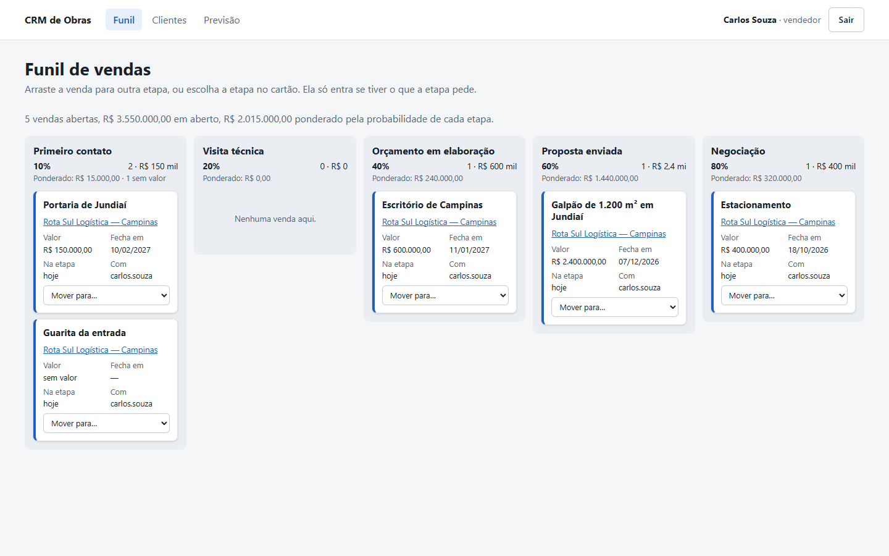
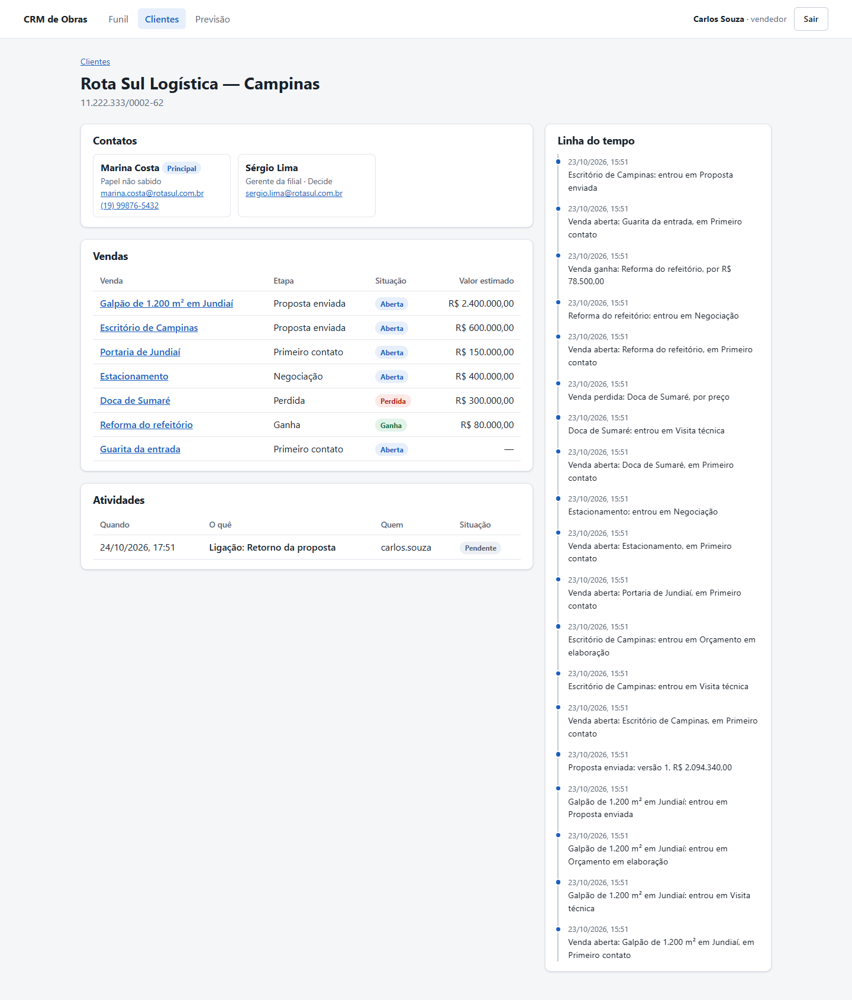
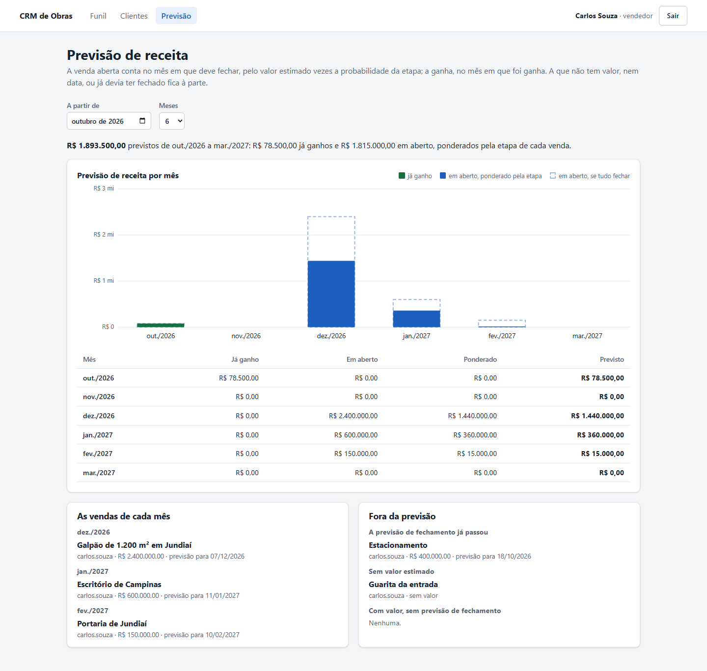

# CRM de Obras

[](https://github.com/MarcusBomfim/Projeto../actions/workflows/ci.yml)

O relacionamento de uma construtora com os clientes, antes da obra existir: o interessado que chega pelo site ou por indicação, as perguntas que dizem se ele vai mesmo comprar, o cliente que já está na base com outro nome, a venda que anda pelo funil, a agenda de cada vendedor, a proposta negociada em versões, a previsão de receita e os relatórios de onde se ganha e se perde, tudo gravado no PostgreSQL, com cada construtora vendo só o que é dela, aberto por uma API REST e por telas no navegador — e, na próxima parte, o contrato que vira obra no [planejamento-obras](https://github.com/MarcusBomfim/Projeto-C--obras).

C# 14 · .NET 10 · ASP.NET Core 10 · EF Core 10 · PostgreSQL 17 · React 19 · TypeScript · Vite · xUnit v3 · Vitest · Testcontainers · Playwright · GitHub Actions

## O problema

Construtora vende pouco e caro: um galpão, um prédio, uma casa. Cada venda leva meses e passa por muita gente — quem pediu o orçamento, o arquiteto, o diretor que assina, o financeiro que paga. Sem um lugar para essa história, ela se espalha em e-mails, conversas de WhatsApp e na memória do vendedor, e vai embora com ele.

Três coisas atrapalham já na porta:

- **Quem não vai comprar consome o tempo de quem vai.** A maioria dos interessados não tem verba, ou a obra é para daqui a anos. É preciso perguntar cedo, e as mesmas perguntas para todos.
- **O mesmo cliente vira vários cadastros.** A filial liga, o diretor manda e-mail, a indicação chega pelo arquiteto — e cada um vira uma "empresa nova".
- **Documento errado vira dor de cabeça no contrato.** CNPJ e CPF têm dígitos verificadores; desde julho de 2026, o CNPJ também pode ter letras.

E, depois da porta, a venda emperra sem que ninguém perceba: a proposta que ninguém cobrou há um mês, o orçamento feito para quem não decide, a previsão de vendas que soma oportunidades sem valor nem data. Na hora do preço, a margem vai embora: o desconto dado por quem não podia dar, a proposta mandada três vezes sem que ninguém saiba qual valeu. E, no fim do mês, ninguém sabe dizer quanto vai entrar, nem por que as vendas se perdem.

## Exemplo

O exemplo inteiro está em [`ExemploDoReadmeTests`](tests/CrmObras.Dominio.Testes/ExemploDoReadmeTests.cs). É um teste: se o código mudar e alguma frase desta página deixar de ser verdade, o build quebra.

A construtora já atende a matriz da Rota Sul, e tem o diretor de obras de contato:

```csharp
var matriz = new Conta("Logística Rota Sul", Documento.De("11.222.333/0001-81"));
matriz.AdicionarContato(new DadosDoContato("Otávio Reis", Email.De("otavio.reis@rotasul.com.br"),
    Telefone.De("(11) 3333-4444"), "Diretor de obras", PapelNaCompra.Decisor));
```

Pelo site chega a Marina, da filial de Campinas, pedindo um galpão. O que ela digitou é lido como as pessoas escrevem — `Marina.Costa@RotaSul.com.br` vira `marina.costa@rotasul.com.br`; `+55 19 99876-5432`, `(19) 99876-5432`:

```csharp
var lead = new Lead(
    new DadosDoLead("Marina Costa", "Rota Sul Logística — Campinas", Documento.De("11.222.333/0002-62"),
        Email.De("Marina.Costa@RotaSul.com.br"), Telefone.De("+55 19 99876-5432"), "Galpão de 1.200 m² em Jundiaí"),
    OrigemDoLead.Site, null, segunda);
```

Na primeira ligação, há verba e a obra é real, mas a Marina não decide, e ainda não há data. O lead não se qualifica, e diz por quê:

```csharp
lead.Avaliar(new Avaliacao(Orcamento: Sim, FalaComQuemDecide: Nao, Necessidade: Sim, Prazo: NaoSabido));
lead.Qualificar(segunda);
// O lead Marina Costa ainda não se qualifica: falta falar com quem decide ou ter o prazo da obra.
```

Na segunda, a obra tem data — março —, e o lead se qualifica. Antes de virar cliente, a busca de duplicados:

```csharp
var duplicados = BuscaDeDuplicados.Do(lead, [matriz]);
// Logística Rota Sul
//   a mesma empresa: 11.222.333/0001-81 tem a raiz do CNPJ do lead
//   Otávio Reis também tem e-mail em rotasul.com.br
```

A filial é da mesma empresa, mas tem CNPJ próprio: é outra conta. A matriz não a recebe por engano, e a conta da filial nasce com a Marina de contato principal:

```csharp
lead.ConverterNaConta(matriz, quarta);
// O lead é do cliente com o documento 11.222.333/0002-62, e a conta Logística Rota Sul tem o documento
// 11.222.333/0001-81: não são o mesmo cliente.

var filial = lead.ConverterEmContaNova(duplicados, quarta);
// Rota Sul Logística — Campinas, 11.222.333/0002-62, contato principal: Marina Costa
```

Se a busca tivesse achado uma conta com o mesmo CNPJ, a conta nova seria recusada — o lead viraria contato dela. E o CNPJ alfanumérico é conferido como o numérico: `12.ABC.345/01DE-35` passa; `12.ABC.345/01DE-53` não confere.

### Do lead à proposta

A venda nasce do lead, no funil padrão da construtora, com a obra que a Marina descreveu de título:

```csharp
var funil = Funil.PadraoDaConstrutora();
// Primeiro contato 10% · Visita técnica 20% · Orçamento em elaboração 40% · Proposta enviada 60% · Negociação 80%

var galpao = AberturaPeloLead.Abrir(lead, filial, funil, "carlos.souza", quarta);
// Galpão de 1.200 m² em Jundiaí, em Primeiro contato
```

A qualificação disse que a Marina não decide, e quem decide fica em aberto. A visita técnica acontece; o orçamento não sai sem quem decide:

```csharp
galpao.MoverPara(funil, visitaTecnica, sexta);
galpao.MoverPara(funil, orcamento, segunda);
// Para a oportunidade Galpão de 1.200 m² em Jundiaí entrar em Orçamento em elaboração, falta quem decide.
```

Na visita, a Marina apresentou o Sérgio, gerente da filial, que decide. Com ele, o orçamento sai — e pular a proposta não pula o que ela pede:

```csharp
var sergio = filial.AdicionarContato(new DadosDoContato("Sérgio Lima", Email.De("sergio.lima@rotasul.com.br"),
    Papel: PapelNaCompra.Decisor));
galpao.DefinirQuemDecide(filial, sergio.Id);
galpao.MoverPara(funil, orcamento, segunda);

galpao.MoverPara(funil, negociacao, quinta);
// Para a oportunidade Galpão de 1.200 m² em Jundiaí entrar em Negociação, falta o valor estimado e a previsão
// de fechamento.

galpao.Estimar(Dinheiro.Reais(2_400_000m));
galpao.PreverFechamento(new DateOnly(2026, 12, 15));
galpao.MoverPara(funil, propostaEnviada, quinta);
```

Três semanas depois, a proposta continua sem resposta. A etapa espera 15 dias, e o quadro do funil mostra a venda parada:

```csharp
var coluna = QuadroDoFunil.Do(funil, [galpao], tresSemanasDepois).Colunas[3];
// Proposta enviada: R$ 2.400.000,00, ponderado a 60%: R$ 1.440.000,00 — parada: Galpão de 1.200 m² em Jundiaí

galpao.TempoEmCadaEtapa(tresSemanasDepois);
// Primeiro contato 2 dias · Visita técnica 3 dias · Orçamento em elaboração 10 dias · Proposta enviada 21 dias
```

### Da proposta ao contrato

A proposta foi junto com a venda para Proposta enviada, em 05/11: três linhas, sem desconto. Cada linha é arredondada ao centavo, e o total é a soma do que o cliente lê:

```csharp
var proposta = new Proposta(galpao, new DadosDaVersao([piso, estrutura, cobertura], 0m,
    new DateOnly(2026, 12, 31), "30% na assinatura e o resto por medição"), quintaDia5);
proposta.Enviar(carlos, Alcadas.Padrao, quintaDia5);
// versão 1: R$ 2.094.340,00
```

Três semanas depois, a venda parada também está sem próximo passo — ninguém marcou nada. O Carlos marca a ligação para sexta, às 10h; às 14h, ela ainda não foi feita, e a agenda começa por ela:

```csharp
Agenda.De("carlos.souza", [], [galpao], quintaDia26).SemProximoPasso;
// Galpão de 1.200 m² em Jundiaí

var retorno = new Atividade(filial, new DadosDaAtividade(TipoDeAtividade.Ligacao, "Retorno da proposta",
    sextaAs10h, sergio.Id), "carlos.souza", quintaDia26, galpao);

Agenda.De("carlos.souza", [retorno], [galpao], sextaAs14h).Atrasadas;
// Retorno da proposta
```

O Sérgio acha caro, e pede 12% para fechar este ano. A ligação só se conclui com o resultado anotado; a versão 2 nasce igual à 1, e o desconto passa da alçada do vendedor — e da do gerente:

```csharp
retorno.Concluir("Achou caro: pede 12% de desconto para fechar este ano", sextaAs14h30);
proposta.NovaVersao();
proposta.Redigir(new DadosDaVersao([piso, estrutura, cobertura], 12m, new DateOnly(2026, 12, 31), condicoes));

proposta.Enviar(carlos, Alcadas.Padrao, segundaDia30);
// O desconto de 12% passa da alçada do vendedor, de 5%: precisa da aprovação do diretor.
proposta.AprovarDesconto(helena, Alcadas.Padrao, segundaDia30);
// O gerente aprova até 10%: o desconto de 12% é do diretor.

proposta.AprovarDesconto(roberto, Alcadas.Padrao, segundaDia30);
proposta.Enviar(carlos, Alcadas.Padrao, segundaDia30);
// versão 2: R$ 2.094.340,00 − R$ 251.320,80 = R$ 1.843.019,20
```

Uma semana depois, o Sérgio aceita, e a venda é ganha pelo total da versão 2 — a proposta aceita e a venda ganha, juntas, ou nenhuma das duas:

```csharp
FechamentoPelaProposta.Aceitar(proposta, galpao, funil, segundaDia7);
// Galpão de 1.200 m² em Jundiaí: ganha por R$ 1.843.019,20
```

E a linha do tempo da filial conta a história para quem assumir a conta:

```text
07/12 Venda ganha: Galpão de 1.200 m² em Jundiaí, por R$ 1.843.019,20
07/12 Proposta aceita: versão 2, R$ 1.843.019,20
30/11 Proposta enviada: versão 2, R$ 1.843.019,20, com 12% de desconto
27/11 Ligação: Retorno da proposta — Achou caro: pede 12% de desconto para fechar este ano
05/11 Galpão de 1.200 m² em Jundiaí: entrou em Proposta enviada
05/11 Proposta enviada: versão 1, R$ 2.094.340,00
26/10 Galpão de 1.200 m² em Jundiaí: entrou em Orçamento em elaboração
23/10 Galpão de 1.200 m² em Jundiaí: entrou em Visita técnica
21/10 Venda aberta: Galpão de 1.200 m² em Jundiaí, em Primeiro contato
```

### Previsão e relatórios

Na primeira segunda de janeiro, a diretoria olha a carteira da filial: o galpão, ganho em dezembro, e mais cinco vendas abertas no último trimestre. A previsão pondera cada venda pela probabilidade da etapa em que está, no mês em que deve fechar — e põe à parte a que devia ter fechado e não fechou:

```csharp
PrevisaoDeReceita.Do([funil], carteira, Mes.De(2027, 1), 3, segundaDia4);
// 01/2027: em aberto R$ 600.000,00, ponderado R$ 360.000,00 — Escritório de Campinas, em Proposta enviada
// 02/2027: em aberto R$ 150.000,00, ponderado R$ 15.000,00 — Portaria de Jundiaí, em Primeiro contato
// 03/2027: em aberto R$ 0,00, ponderado R$ 0,00
// vencida: Estacionamento, com previsão para 18/12/2026
```

A conversão acompanha as seis vendas que nasceram no trimestre até onde cada uma chegou — a que pulou uma etapa passou por ela — e mede a taxa de ganho só entre as que já fecharam, para comparar com a probabilidade configurada:

```text
Primeiro contato (10%):        chegaram 6 — ganhas 1, perdidas 2 — 33,3% de ganho
Visita técnica (20%):          chegaram 5 — ganhas 1, perdidas 2 — 33,3% de ganho
Orçamento em elaboração (40%): chegaram 4 — ganhas 1, perdidas 1 — 50% de ganho
Proposta enviada (60%):        chegaram 3 — ganhas 1, perdidas 0 — 100% de ganho
Negociação (80%):              chegaram 2 — ganhas 1, perdidas 0 — 100% de ganho
```

O ciclo do galpão, a única venda ganha, foi de 47 dias — 32 deles com a proposta na mão do cliente. E as perdas dizem onde agir: R$ 380.000,00 em duas vendas, uma por preço, para a Construtora Beta, no orçamento; outra sem resposta, depois da visita técnica.

### Gravado, e cada construtora no seu

Tudo isso vai para o PostgreSQL. Cada agregado é um documento, lido de volta pelas mesmas regras que o criaram; cada gravação confere a versão que foi lida, e quem grava por cima do que não viu é recusado — como confere [`ConcorrenciaTests`](tests/CrmObras.Infraestrutura.Testes/Persistencia/ConcorrenciaTests.cs), num PostgreSQL de verdade:

```csharp
var daAna = await contas.Obter(conta.Id);       // versão 1
var doBruno = await contas.Obter(conta.Id);     // versão 1

daAna.Agregado.Renomear("Logística Rota Sul");
await contas.Atualizar(daAna.Agregado, daAna.Versao);      // versão 2

doBruno.Agregado.Renomear("Rota Sul Ltda");
await contas.Atualizar(doBruno.Agregado, doBruno.Versao);
// A conta … mudou desde a versão 1: está na versão 2. Leia de novo e refaça a alteração.
```

E a conta de uma construtora não existe para outra — nem pelo código, que filtra toda consulta, nem pelo banco, que filtra de novo, linha a linha.

### Pela API

A mesma história, pela API REST. Cada pedido leva um JWT do provedor de identidade, com a construtora, o login e o cargo de quem pede — a construtora nunca vem na URL. Criar exige uma chave de idempotência:

```http
POST /api/leads
Authorization: Bearer eyJhbGciOi…
Idempotency-Key: 6f1c2a54-9b1e-4f07-8d4c-2c4e5a0b7d13
Content-Type: application/json

{ "nome": "Marina Costa", "origem": "Site", "documento": "11.222.333/0002-62", "email": "Marina.Costa@RotaSul.com.br", … }
```

```http
HTTP/1.1 201 Created
Location: /api/leads/0199e3b4-…
ETag: "1"
```

Repetida com a mesma chave — a resposta se perdeu no sinal fraco da obra, e o celular tentou de novo —, a criação devolve a mesma resposta, com `Idempotent-Replayed: true`, e não cria um segundo lead ([ADR-0013](docs/adr/0013-criacao-com-chave-de-idempotencia.md)). Toda alteração leva a versão que leu. A conversão procura os duplicados no próprio servidor, e grava o lead e a conta nova numa transação só:

```http
POST /api/leads/0199e3b4-…/conversao
If-Match: "4"

{}
```

Se alguém mexeu no lead no meio, a resposta é 412, com a versão atual. E a regra do negócio responde na língua de quem usa — todo erro sai em ProblemDetails, com um tipo que aponta para a [explicação](docs/api/problemas.md):

```json
{
  "type": "https://github.com/MarcusBomfim/Projeto../blob/main/docs/api/problemas.md#regra-do-negocio",
  "title": "O pedido fere uma regra do negócio.",
  "status": 422,
  "detail": "O desconto de 12% passa da alçada do vendedor, de 5%: precisa da aprovação do diretor.",
  "instance": "POST /api/propostas/0199e3b4-…/envio",
  "traceId": "00-4bf92f3577b34da6a3ce929d0e0e4736-00f067aa0ba902b7-01"
}
```

Ler é de qualquer pessoa da construtora; "quem vende" é o vendedor, o gerente ou o diretor; "a gerência", o gerente ou o diretor ([ADR-0014](docs/adr/0014-contrato-http.md)):

| Recurso | Quem altera | O que mais faz |
|---|---|---|
| `/api/contas` | quem vende; remover, a gerência | contatos, contato principal, linha do tempo |
| `/api/leads` | quem vende; remover, a gerência | qualificação, descarte, duplicados, conversão |
| `/api/funis` | a gerência | o funil padrão, as etapas, o quadro |
| `/api/oportunidades` | quem vende; passar adiante e remover, a gerência | a venda do lead, etapa, ganho, perda, reabertura |
| `/api/atividades` | quem vende; remover, a gerência | reagendar, passar adiante, concluir, cancelar, a agenda |
| `/api/propostas` | quem vende; aprovar desconto e remover, a gerência | versões, envio, o aceite que ganha a venda, recusa |
| `/api/relatorios` | ninguém: é só leitura | previsão, conversão, ciclo e perdas |

O exemplo desta página inteiro — do formulário do site aos relatórios do trimestre — roda pela API num teste, cada passo por quem tem o papel para ele e no dia em que acontece: [`ExemploDoReadmePelaApiTests`](tests/CrmObras.Api.Testes/ExemploDoReadmePelaApiTests.cs).

### No navegador

O funil em kanban, uma coluna por etapa, com o total e o ponderado de cada uma. Arrasta-se o cartão para outra etapa — ou, sem mouse, escolhe-se a etapa no seletor do próprio cartão —, e quem decide é a API: o cartão só muda de coluna com a resposta, e a guarita, sem quem decide, não entra no orçamento — a mensagem do domínio aparece na tela ([ADR-0015](docs/adr/0015-front-end-tipado-pelo-contrato-da-api.md)).



A ficha do cliente, para quem vai atendê-lo: com quem se fala, o que está sendo vendido e em que etapa, o que está marcado — e a história, do mais recente para o mais antigo.



E a previsão: o previsto de cada mês sobre o teto do que está em aberto, a tabela dos mesmos números ao lado — é ela que um leitor de tela lê —, as vendas de cada mês, e à parte as que a previsão não conta.



As três telas são do teste de ponta a ponta, [`carteira-do-readme.spec.ts`](e2e/testes/carteira-do-readme.spec.ts): ele cria a carteira da Rota Sul pela API, nas datas de hoje, abre o Chrome contra a pilha inteira e, com `IMAGENS=1`, tira estas fotos.

## Roteiro

O projeto é construído em partes, cada uma entregue funcionando, testada e documentada.

| Parte | Conteúdo | |
|--:|---|---|
| 1 | Clientes e leads: contas, contatos, CNPJ e CPF conferidos, qualificação, conversão e busca de duplicados | ✅ |
| 2 | Funil de vendas: etapas configuráveis, oportunidades, regras de passagem e o tempo em cada etapa | ✅ |
| 3 | Atividades e propostas: agenda com atrasos, propostas com versões e desconto com alçada de aprovação | ✅ |
| 4 | Previsão e relatórios: receita prevista ponderada, conversão por etapa, ciclo de venda e motivos de perda | ✅ |
| 5 | Persistência com EF Core e PostgreSQL, multiempresa com segurança por linha, testes com Testcontainers | ✅ |
| 6 | API REST: JWT, autorização por papel, ProblemDetails, concorrência otimista e idempotência | ✅ |
| 7 | Front-end em React: funil em kanban, ficha do cliente com a linha do tempo e painel da previsão | ✅ |
| 8 | Integração com o planejamento-obras por eventos — a proposta aceita vira obra —, observabilidade, Docker e entrega contínua | |

## O que já está pronto

**Parte 1 — clientes e leads**

- **CNPJ e CPF conferidos pelos dígitos verificadores**, com ou sem máscara. O CNPJ alfanumérico, que a Receita emite desde julho de 2026, é aceito com a mesma conta: cada letra vale o seu código ASCII menos 48. A raiz do CNPJ — a mesma na matriz e nas filiais — fica exposta.
- **E-mail e telefone como as pessoas escrevem.** O e-mail é guardado em minúsculas; o telefone, como DDD e número, aceito com `+55`, com o zero da operadora, com parênteses e traço — e o DDD tem de existir no plano da Anatel, o celular começa com 9 e o fixo de 2 a 5.
- **Conta e contatos.** A conta é o cliente, empresa ou pessoa; o documento pode chegar depois, mas, informado, não muda. Os contatos têm o papel na compra — decisor, influenciador, financeiro, usuário —, um deles é o principal, e o e-mail não se repete dentro da conta.
- **Lead com origem e qualificação.** Quatro perguntas — orçamento, quem decide, necessidade, prazo — e uma régua escrita: necessidade e orçamento confirmados, e quem decida ou prazo. O que não qualifica diz o que falta; o descartado tem motivo, e pode ser reaberto.
- **Busca de duplicados com indícios**, do mais forte para o mais fraco: mesmo documento, mesma raiz de CNPJ, mesmo e-mail, mesmo telefone, mesmo nome — sem acento, pontuação e "Ltda" — e mesmo domínio de e-mail de empresa.
- **Conversão que não duplica.** Converter em conta nova exige a busca feita, e é recusado se já existe conta com o mesmo documento. Na conta existente, o documento é conferido e o contato com o mesmo e-mail, reaproveitado.

**Parte 2 — funil de vendas**

- **Funil configurável.** Etapas abertas com nome, probabilidade de fechar, dias esperados e requisitos para entrar; um funil padrão de construtora para começar. A probabilidade vai de 1% a 99% e não cai conforme a venda avança. No fim, sempre, a Ganha (100%) e a Perdida (0%), que só mudam de nome.
- **Requisitos que se acumulam.** Valor estimado, previsão de fechamento e quem decide: para entrar numa etapa, valem os dela e os de todas as anteriores — pular etapa não pula a exigência. A primeira etapa não tem requisito, e nenhuma mudança no funil põe em primeiro uma que tenha.
- **Etapa arquivada, e não apagada.** Sai do funil e não recebe mais venda, mas guarda a história de quem passou por ela; o nome continua ocupado, e, reativada, ela volta no lugar que a probabilidade indica.
- **Oportunidade que anda pelo funil**, para a frente e para trás, conferindo os requisitos e dizendo tudo o que falta de uma vez. Quem decide é um contato da conta da venda; os valores são positivos e em centavos.
- **Ganha e perdida com caminho próprio.** Ganhar pede o valor fechado, e a venda ganha não muda mais. Perder pede o motivo — preço, prazo, concorrente, projeto cancelado, sem crédito, sem resposta, outro —, com o concorrente ou a observação quando o motivo exige; a perdida pode ser reaberta.
- **Cada passagem por etapa guardada**, com a entrada e a saída: o tempo em cada etapa, somado quando a venda volta, e a venda parada, que passou dos dias que a etapa espera. Fechada a venda, o relógio para.
- **Do lead à venda.** O lead convertido abre a oportunidade na conta dele, com o interesse de título e o contato de quem decide, se a qualificação disse que ele decide; a venda lembra de que lead veio.
- **Quadro do funil**: uma coluna por etapa, com as vendas da mais antiga para a mais recente, o total, o ponderado pela probabilidade, as paradas e as que ainda não têm valor.

**Parte 3 — atividades e propostas**

- **Atividades da conta e da venda.** Ligação, e-mail, reunião, visita ou tarefa, com assunto, data, responsável e o contato da conta com quem se vai falar. Concluir pede o resultado; cancelar, o motivo; e a encerrada não muda mais. Adiar conta — antecipar não.
- **Agenda do vendedor**: as atrasadas, da mais antiga; as do resto do dia, pela hora, no fuso de quem olha; e as vendas abertas sem próximo passo — nenhuma atividade pendente, de quem quer que seja.
- **Proposta em versões.** A versão nasce em rascunho e muda à vontade; enviada, não muda mais, e a seguinte nasce igual à última e a substitui quando vai. O cliente aceita, dentro da validade, ou recusa com o motivo.
- **Valores como o cliente os lê**: cada linha ao centavo, o subtotal pela soma das linhas, o desconto sobre o subtotal, também ao centavo.
- **Desconto com alçada.** Cada cargo dá até uma porcentagem — 5%, 10% e 15%, na padrão. Acima da alçada de quem envia, precisa da aprovação de quem tem alçada para o desconto; redigir de novo desfaz a aprovação, e a alçada é conferida no envio.
- **Proposta aceita, venda ganha.** O aceite ganha a venda pelo total da versão aceita, e os dois lados são conferidos antes de qualquer mudança.
- **Linha do tempo do cliente**, do mais recente para o mais antigo: as vendas e as etapas, as atividades feitas com o resultado, as propostas enviadas, aceitas e recusadas.

**Parte 4 — previsão e relatórios**

- **Previsão de receita mês a mês.** A venda aberta entra no mês da previsão de fechamento, pelo valor estimado vezes a probabilidade da etapa; a ganha, no mês em que foi ganha, pelo valor fechado. O ponderado é arredondado ao centavo uma vez por mês.
- **A previsão não chuta.** A venda sem valor, a sem data e a de previsão vencida ficam fora dos meses, cada uma numa lista, para quem cuida dela corrigir.
- **Conversão por etapa.** Das vendas que nasceram no período, quantas chegaram a cada etapa — alcançá-la ou uma depois dela —, quantas foram além, e a taxa de ganho entre as que já fecharam, para comparar com a probabilidade configurada.
- **Ciclo de venda**, das ganhas no período: a mediana, a média, o mais curto e o mais longo, e o tempo típico em cada etapa.
- **Motivos de perda** no período: por motivo, por concorrente — o nome comparado como na busca de duplicados — e pela etapa em que a venda estava, da mais frequente para a menos, e no empate, da que mais valia.
- **Mês e período como valores**, com o fuso de quem pede: a venda ganha às 22h de 31/10 em Brasília é de outubro para quem está em Brasília.

**Parte 5 — persistência**

- **Cada agregado é um documento `jsonb`**, numa tabela por agregado, com ao lado só o que o banco precisa enxergar: identidade, versão, formato, construtora, e o que se lista sem abrir o documento — nome, CNPJ ou CPF, situação, vendedor, data da atividade.
- **A reconstituição passa pelas regras.** O lead volta refazendo os passos; a venda, com as passagens encadeadas no tempo e a situação coerente com o que carrega; a proposta, com as versões contando uma história que as regras produzem. Dado gravado que fere uma regra é recusado na leitura, dizendo o quê.
- **Leitura estrita**: propriedade que falta ou sobra, nulo onde não cabe, enum pelo número ou formato de outra versão — nada disso vira, em silêncio, um agregado com um campo zerado.
- **O banco confere o que consegue sozinho**: versão e formato positivos, documento que é objeto, situação que existe, CNPJ ou CPF que não se repete na construtora, e as referências — a venda de uma conta e de um funil da mesma construtora, que não saem do banco enquanto alguém aponta para eles.
- **Duas barreiras entre as construtoras**: o filtro de toda consulta no código, e a segurança por linha do PostgreSQL, forçada até para o dono das tabelas, com a construtora declarada a cada conexão. Cada barreira testada sem a outra.
- **Concorrência otimista** com a versão no `where`, num comando só: de dez gravações ao mesmo tempo a partir da mesma versão, passa uma. O que o banco recusa vira exceção com nome e mensagem para gente.
- **Repositórios que respondem ao que o domínio pergunta**: a conta pelo documento, os leads de uma situação, as vendas de um funil, a agenda de um vendedor, a história de uma conta.

**Parte 6 — API REST**

- **JWT do provedor de identidade**, com a construtora, o login e o cargo de quem pede. A API confere assinatura, emissor, audiência e validade, e não emite token; em desenvolvimento, quem emite é o `dotnet user-jwts`.
- **Autorização pelo cargo do comercial.** Ler é de qualquer pessoa da construtora; cuidar de leads, contas, vendas, atividades e propostas, de quem vende; configurar funis, aprovar desconto, passar a venda a outro vendedor e remover o que foi cadastrado errado, da gerência. Endpoint que esquecer a política ainda exige ser da construtora, e, sem token, nem rota que não existe se descobre.
- **Quem pede é quem responde**: o login do token é o responsável da venda aberta, da atividade marcada e do envio da proposta; o cargo mais alto dele é a alçada para o desconto.
- **A versão na ETag.** `If-Match` em toda alteração — sem ele, 428; com versão velha, 412 e a atual no corpo —, e `If-None-Match` com a versão atual dá 304.
- **Criar é seguro de repetir.** A `Idempotency-Key` é reservada na mesma transação da criação; a repetição recebe a resposta original, igual, e dez repetições ao mesmo tempo criam uma só. A mesma chave com outro pedido é recusada; o pedido que falha não gasta a chave.
- **O que grava dois agregados grava numa transação**: o lead convertido e a conta nova; a proposta aceita e a venda ganha.
- **Os duplicados procurados no servidor.** O banco escolhe as contas candidatas — mesmo documento ou raiz de CNPJ, mesmo nome, e-mail, telefone ou domínio de empresa —, e o domínio diz o que cada uma tem em comum com o lead.
- **Todo erro em ProblemDetails** (RFC 9457), de um catálogo com a explicação de cada tipo em [`docs/api/problemas.md`](docs/api/problemas.md): a regra do negócio com a mensagem do domínio; o erro interno, só com o id do rastreio.
- **Entrada estrita**: campo que falta ou sobra, nulo onde não cabe, enum em número, número em texto, dia que não vem como `2026-10-19` — 400, dizendo o quê.
- **O dia é o da construtora.** O servidor conta em UTC; a validade da proposta, o "hoje" da agenda e os dias dos relatórios são os do fuso configurado — e a agenda aceita o fuso de quem a olha de longe.
- **Documento OpenAPI** em `/openapi/v1.json`, com o esquema de autenticação e os cabeçalhos que cada endpoint exige.

**Parte 7 — front-end**

- **Funil em kanban**: uma coluna por etapa, com a probabilidade, quantas vendas, o total e o ponderado; cada cartão com a conta, o valor, a previsão, há quanto tempo está na etapa e o selo de parada. A etapa arquivada que ainda tem venda aparece no fim, e não recebe venda nova.
- **Mover é pedir à API.** Arrastar o cartão — ou escolher a etapa no seletor dele, pelo teclado ou por leitor de tela — faz o mesmo `PUT`, com a versão que o quadro mostrou no `If-Match`. O cartão só muda de coluna com a resposta; a recusa do domínio aparece como ele a escreveu, e o quadro é lido de novo.
- **Ficha do cliente**: os contatos, com o papel na compra, o principal marcado, e o e-mail e o telefone que abrem o programa certo; as vendas, com o nome da etapa; as atividades, com as atrasadas marcadas; e a linha do tempo.
- **Previsão de receita**: o previsto de cada mês em barras de SVG feito à mão, sobre o teto do que está em aberto, com a tabela dos números ao lado; as vendas de cada mês; e as que a previsão não conta — vencidas, sem valor, sem data. O mês e o período ficam no endereço.
- **Tipado pelo contrato.** O documento OpenAPI fica no repositório, um teste da API falha se ela mudar sem ele, e os tipos do front-end saem dele: caminho, parâmetro, resposta, enum — e os cabeçalhos exigidos: o `If-Match` esquecido é erro de compilação.
- **Sessão pelo token** do provedor de identidade, guardado na aba: quem entrou e o cargo no topo; token recusado ou vencido leva de volta à entrada, dizendo por quê; e trocar de sessão esvazia o cache, para uma construtora não ver o que a outra leu.

## Decisões

As decisões que mudam o desenho do sistema estão registradas em [`docs/adr`](docs/adr):

- [ADR-0001](docs/adr/0001-linguagem-ubiqua-em-portugues.md) — o código fala a língua do comercial: `Lead`, `Conta`, `Qualificacao`, `Cnpj`.
- [ADR-0002](docs/adr/0002-a-conta-e-identificada-pelo-documento.md) — a conta é identificada pelo documento, que pode chegar depois mas não muda; matriz e filial são contas com a mesma raiz; cada agregado tem identidade do seu tipo.
- [ADR-0003](docs/adr/0003-qualificacao-e-conversao-do-lead.md) — o lead se qualifica por critérios escritos, e só vira conta depois de procurar os duplicados.
- [ADR-0004](docs/adr/0004-funil-configuravel-com-requisitos-cumulativos.md) — o funil é configurável, a probabilidade não cai e os requisitos se acumulam.
- [ADR-0005](docs/adr/0005-a-oportunidade-guarda-cada-passagem-pelo-funil.md) — a oportunidade guarda cada passagem pelo funil, e a venda ganha não se reabre.
- [ADR-0006](docs/adr/0006-toda-venda-aberta-tem-um-proximo-passo.md) — toda venda aberta tem um próximo passo, e a atividade feita deixa o resultado.
- [ADR-0007](docs/adr/0007-proposta-em-versoes-e-desconto-com-alcada.md) — a proposta é feita em versões, e o desconto acima da alçada precisa de quem aprove.
- [ADR-0008](docs/adr/0008-previsao-ponderada-pela-etapa-e-sem-chute.md) — a previsão de receita é ponderada pela etapa, e não chuta.
- [ADR-0009](docs/adr/0009-conversao-por-quem-chegou-e-ciclo-pela-mediana.md) — a conversão conta quem chegou a cada etapa, e o ciclo de venda é a mediana.
- [ADR-0010](docs/adr/0010-reconstituicao-dos-agregados-passa-pelas-regras.md) — a reconstituição dos agregados é interna, e passa pelas regras.
- [ADR-0011](docs/adr/0011-documentos-jsonb-separados-por-construtora.md) — cada agregado é um documento `jsonb`, e cada construtora só enxerga os seus.
- [ADR-0012](docs/adr/0012-concorrencia-otimista-com-versao-explicita.md) — concorrência otimista, com a versão conferida pelo banco num comando só.
- [ADR-0013](docs/adr/0013-criacao-com-chave-de-idempotencia.md) — criar exige chave de idempotência, gravada na mesma transação da criação.
- [ADR-0014](docs/adr/0014-contrato-http.md) — o contrato HTTP: token com a construtora, política pelo cargo, versão na ETag, erro em ProblemDetails.
- [ADR-0015](docs/adr/0015-front-end-tipado-pelo-contrato-da-api.md) — o front-end é tipado pelo contrato da API, a regra fica no domínio e o estado do servidor, no cache.

E algumas que não precisaram de ADR:

- **O domínio não depende de nada** além da biblioteca padrão do .NET — nem do banco. Um teste de arquitetura falha se ele passar a referenciar qualquer outro assembly, e só a infraestrutura e os testes do domínio enxergam os internos dele.
- **Valores só nascem pela leitura que valida.** CNPJ, CPF, e-mail e telefone não têm construtor público: um CNPJ que não confere não existe.
- **Dinheiro em `decimal`**, arredondado ao centavo pela NBR 5891 — meio centavo vai para o par — só onde a regra manda: em cada linha da proposta, no desconto, no ponderado de cada coluna do quadro e de cada mês da previsão.
- **Relatório não guarda nada.** Previsão, conversão, ciclo e perdas são calculados do histórico das vendas, e qualquer período passado pode ser refeito.
- **Erros de quem usa vêm todos de uma vez.** O contato sem nome e sem meio de contato ouve as duas coisas numa mensagem só.
- **Aviso é erro.** Analisadores no nível `latest-recommended`, estilo verificado no build e `dotnet format` conferido no CI.

## Testes

- **Exemplos conferidos à mão**: os CNPJs e CPFs de exemplo, um CNPJ alfanumérico com a conta dos verificadores feita no papel, os DDDs que não existem, os e-mails que só parecem e-mail.
- **Propriedades em 400 casos sorteados**, com semente fixa: CNPJs numéricos e alfanuméricos e CPFs com os verificadores calculados pelo próprio teste — por uma conta escrita à parte — são aceitos, voltam iguais da máscara, e com um verificador trocado são recusados.
- **A régua da qualificação** em tabela: cada combinação de respostas, e o que falta em cada uma.
- **A busca de duplicados**, um indício de cada tipo, a ordem entre eles, o provedor gratuito que não aproxima ninguém e o nome comparado sem acento, pontuação e natureza jurídica.
- **As regras do funil** em cada mudança — criar, adicionar, alterar, mover, arquivar, reativar —, com os limites de probabilidade, prazo e nome, e a mensagem de cada recusa.
- **O andar da oportunidade**: requisitos acumulados, volta, etapa arquivada, instantes fora de ordem, ganho, perda, reabertura, o tempo somado em cada etapa e a venda parada no minuto em que passa do prazo.
- **A agenda** no minuto em que a atividade atrasa, no fuso de quem olha, e a venda cujo próximo passo é de outra pessoa.
- **A proposta**: o arredondamento de cada linha e do desconto, a alçada de cada cargo nos limites, a aprovação desfeita ao redigir de novo, a alçada reduzida depois da aprovação, a validade até o último minuto e o aceite que não deixa a venda e a proposta pela metade.
- **Os relatórios**: o mês do ganho no fuso de quem pede, o meio centavo que só aparece somado no mês, a venda que pulou etapa, a reaberta, a mediana de quantidades par e ímpar, o concorrente escrito de dois jeitos e a etapa arquivada.
- **A reconstituição** de cada agregado, ida e volta, e cada estado que as regras não produzem — passagem que não encadeia, rascunho no meio das versões, lead convertido sem conta — recusado com a razão.
- **O formato de cada documento** escrito por extenso, e a leitura estrita contra cada jeito de estragá-lo.
- **O banco de verdade**, num contêiner com PostgreSQL 17: cada restrição, cada chave estrangeira — inclusive a que não deixa uma venda apontar para a conta de outra construtora —, a segurança por linha em toda tabela, cada barreira do isolamento sem a outra, a conexão que volta ao pool sem levar a construtora, e as dez gravações simultâneas de que só uma passa.
- **A API, em memória, contra o PostgreSQL do contêiner**: todo endpoint com política, `If-Match` nas alterações e chave de idempotência nas criações — conferido percorrendo os endpoints mapeados, e no documento OpenAPI —; o token sem assinatura, vencido, de outro emissor ou sem construtora; o que cada cargo pode e não pode; a repetição, a chave reutilizada e as dez criações simultâneas; as dez alterações simultâneas sobre a mesma versão; a construtora que não enxerga a outra; a conversão concorrente que não deixa conta a mais; e o aceite que, se a venda não grava, desfaz a proposta junto.
- **O contrato publicado** é o que a API serve, e os tipos do front-end batem com ele.
- **O front-end com a aplicação inteira aberta**: as rotas, a sessão e o cache de verdade, e só a API de mentira, que recusa o pedido que o teste não previu. O kanban que move pelo seletor e pelo arrasto com a versão lida, mostra a recusa do domínio e não pede nada quando o cartão é solto na própria coluna; a ficha; a previsão com a tabela; a sessão que vence com a tela aberta. E a geometria do gráfico, com números.
- **De ponta a ponta, no Chrome**: a carteira da Rota Sul criada pela API, e o navegador arrastando a venda de verdade, vendo a recusa do domínio, abrindo a ficha e conferindo a previsão — contra o banco, a API e o front-end de produção.
- **O exemplo deste README**, de ponta a ponta — pelo domínio, pela API e no navegador.
- **Arquitetura.** O domínio só referencia a biblioteca padrão; toda classe pública é selada, estática ou abstrata; nenhuma propriedade tem `set` público; os valores não têm construtor público; e todo agregado tem identidade própria.

## Como rodar

Pré-requisitos: o [SDK do .NET 10](https://dotnet.microsoft.com/download) e, para os testes de banco, o Docker.

```bash
dotnet test --solution CrmObras.slnx
```

Sem Docker, os testes de banco são pulados, com o motivo; no CI, Docker indisponível é falha. As migrações são geradas com o `dotnet-ef` do repositório (`dotnet tool restore`).

Para criar o banco num PostgreSQL local:

```bash
docker run -d --name crm-obras-db -e POSTGRES_PASSWORD=postgres -p 5432:5432 postgres:17.6-alpine
dotnet tool restore
dotnet ef database update --project src/CrmObras.Infraestrutura --connection "Host=localhost;Database=crm_obras;Username=postgres;Password=postgres"
```

Para subir a API em `http://localhost:5090` — o documento OpenAPI fica em `/openapi/v1.json` — e gerar um token de desenvolvimento, com a construtora, o login e o cargo que quiser:

```bash
dotnet run --project src/CrmObras.Api
dotnet user-jwts create --project src/CrmObras.Api --role vendedor --claim construtora=0199e3b4-0000-7000-8000-000000000001 --claim preferred_username=carlos.souza
```

Em desenvolvimento, a API conecta como `postgres`, um superusuário, que passa por cima da segurança por linha — o filtro do código continua separando as construtoras. Em produção, ela conecta com um papel comum, que a segurança por linha alcança ([ADR-0011](docs/adr/0011-documentos-jsonb-separados-por-construtora.md)). As alçadas de desconto e o fuso da construtora estão em `appsettings.json`.

O front-end precisa do [Node.js 24](https://nodejs.org). Com a API no ar, ele abre em `http://localhost:5190` e pede o token — o do `dotnet user-jwts`, com o cargo, a construtora e o login que quiser. O Vite repassa `/api` para a API, e os dois ficam na mesma origem:

```bash
npm ci --prefix web
npm --prefix web run dev
```

Os testes do front-end não precisam da API:

```bash
npm --prefix web run teste
```

Os de ponta a ponta compilam e sobem a API e o front-end de produção contra um PostgreSQL próprio, na porta 55434, e abrem o Google Chrome instalado. Com `IMAGENS=1`, refazem as imagens deste README:

```bash
docker run -d --name crm-obras-e2e -e POSTGRES_PASSWORD=postgres -p 55434:5432 postgres:17.6-alpine
npm ci --prefix e2e
npm --prefix e2e run teste
```

Quando a API muda, o contrato publicado é regravado pelo próprio teste dele, e os tipos do front-end saem do contrato:

```bash
ATUALIZAR_CONTRATO=1 dotnet test --solution CrmObras.slnx
npm --prefix web run tipos
```

## Estrutura

```text
src/CrmObras.Dominio/                  regras do negócio, sem dependências
  Comum/                               exceção de domínio, identidade, dinheiro, mês, período e textos
  Identificacao/                       CNPJ, numérico e alfanumérico, e CPF
  MeiosDeContato/                      e-mail e telefone
  Clientes/                            conta, contatos e o papel de cada um na compra
  Leads/                               lead, qualificação, descarte, conversão e busca de duplicados
  Funis/                               funil, etapas, probabilidade e requisitos
  Oportunidades/                       oportunidade, passagens pelas etapas, abertura pelo lead e quadro do funil
  Atividades/                          atividade e agenda do vendedor
  Propostas/                           proposta, versões, itens, alçadas e o aceite que ganha a venda
  Historico/                           linha do tempo do cliente
  Relatorios/                          previsão de receita, conversão por etapa, ciclo de venda e motivos de perda
src/CrmObras.Infraestrutura/           o que o domínio não sabe
  Documentos/                          o formato gravado de cada agregado, e a leitura estrita
  Persistencia/                        contexto, registros, migrações, repositórios, chaves de idempotência e a construtora em cada conexão
src/CrmObras.Api/                      a API REST
  Hospedagem/                          os serviços, o caminho de cada pedido e o documento OpenAPI
  Seguranca/                           papéis, políticas, e a construtora e quem pede, lidos do token
  Http/                                ETag, If-Match, idempotência, o catálogo dos problemas e a tradução das exceções
  Recursos/                            um recurso por agregado, a agenda, o quadro, os relatórios e a linha do tempo
tests/CrmObras.Dominio.Testes/         exemplos, propriedades, a reconstituição e o exemplo deste README
tests/CrmObras.Infraestrutura.Testes/  documentos, e o banco de verdade num contêiner
tests/CrmObras.Api.Testes/             a API em memória, contra o banco num contêiner, e o exemplo deste README pela API
tests/CrmObras.Arquitetura.Testes/     regras que o domínio não pode quebrar
web/                                   o front-end em React
  src/api/                             o cliente HTTP e os tipos gerados do contrato
  src/sessao/                          o token, a entrada e quem entrou
  src/funil/                           o kanban do funil, e mover a venda
  src/contas/                          os clientes e a ficha de cada um
  src/previsao/                        o painel da previsão, e a geometria do gráfico
e2e/                                   os testes de ponta a ponta, no Chrome, contra a pilha inteira
docs/adr/                              decisões de arquitetura
docs/api/                              o contrato da API, em OpenAPI, e os problemas que ela devolve
docs/imagens/                          as telas deste README, tiradas pelo teste de ponta a ponta
```
